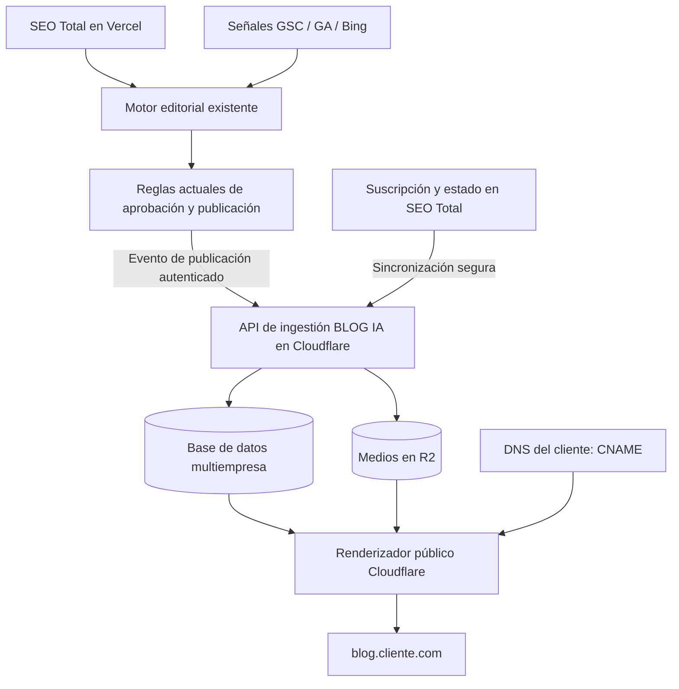

# BLUEPRINT MAESTRO — BLOG IA

**Proyecto:** BLOG IA — canal de publicación inteligente de SEO Total  
**Ecosistema propietario:** La Solución Web  
**Aplicación principal:** SEO Total  
**Versión:** 1.0 — Especificación funcional y técnica para implementación  
**Fecha:** 15 de octubre de 2026  
**Estado:** Definiciones de producto aprobadas; decisiones de ingeniería sujetas a validación técnica

---

## 1. Resumen ejecutivo

BLOG IA es un módulo **incluido en la suscripción de SEO Total** que permite a empresas con sitios construidos en Wix, Shopify, WordPress, HTML o cualquier otra plataforma disponer de un blog público moderno en un **subdominio propio**, por ejemplo `blog.segurosdesaludyvida.com`, aunque su sitio principal no tenga blog.

BLOG IA **no crea un segundo motor de artículos**. Reutiliza íntegramente las señales, generación de oportunidades, contenidos, controles de aprobación y reglas de publicación ya existentes en SEO Total. Su nueva responsabilidad es recibir el contenido aprobado, organizarlo y servirlo públicamente en una infraestructura independiente de Cloudflare. SEO Total continúa en Vercel.

**Principio rector:** SEO Total crea y administra la inteligencia editorial; BLOG IA publica y presenta el contenido bajo el subdominio del cliente.

**Propuesta de valor:** «Tu página web no necesita tener blog para empezar a publicar contenido estratégico bajo tu propio dominio. BLOG IA se conecta sin modificar tu sitio actual».

### 1.1 Objetivos

- Activar un blog por cuenta de SEO Total, bajo un subdominio controlado por el cliente.
- Evitar migraciones, cambios de código o intervenciones sobre la página principal del cliente.
- Ofrecer una experiencia visual coherente con la marca y un diseño editorial de alta calidad.
- Permitir rastreo e indexación técnicamente correctos en buscadores y facilitar descubrimiento por sistemas de respuesta con IA.
- Mantener reglas editoriales y automatizaciones existentes, sin duplicar lógica.
- Administrar numerosos blogs desde **una sola cuenta de Cloudflare**, con aislamiento estricto entre clientes.

### 1.2 No objetivos

- No reemplazar el sitio principal del cliente.
- No editar automáticamente menús ni código de Wix, Shopify, WordPress u otros sistemas.
- No desarrollar un segundo dashboard de analítica: Google Search Console será la herramienta principal de seguimiento orgánico.
- No garantizar posiciones, indexación, tráfico, menciones o citaciones en ChatGPT, Gemini u otros motores.
- No imponer enlaces comerciales automáticos dentro de artículos: las decisiones editoriales siguen perteneciendo al motor de SEO Total.
- No lanzar en la primera versión publicación en `cliente.com/blog`; esa modalidad requiere proxy o integración avanzada y queda para evaluación futura.

---

## 2. Decisiones de producto aprobadas

| Área | Decisión vinculante |
|---|---|
| Nombre | **BLOG IA** |
| Disponibilidad | Visible y disponible para todas las cuentas de SEO Total; activación voluntaria |
| Precio | Incluido en la suscripción actual, sin cargo adicional específico |
| Cantidad | Un subdominio de blog por cuenta |
| Publicación | Mismas reglas de SEO Total para generación, aprobación, programación y publicación |
| Fuentes de señales | Reutilizar conexiones existentes de Google Search Console, Google Analytics y Bing Webmaster Tools |
| Infraestructura | Blogs en Cloudflare, separados del software principal alojado en Vercel |
| Cuenta Cloudflare | Una sola cuenta operativa para todos los blogs, con aislamiento multiempresa |
| Almacenamiento | Contenido y medios de BLOG IA separados del almacenamiento del software principal |
| DNS | Subdominio mediante CNAME y verificación automática |
| SSL | HTTPS y certificado gestionados automáticamente al completar requisitos del dominio |
| Identidad | Detección de logo, colores, nombre comercial, header y footer; revisión y edición por cliente |
| Diseño | Plantilla única, blanca, contemporánea, minimalista, responsive |
| Estructura | Home, categorías, búsqueda, paginación y artículo individual |
| Categorías | Sugeridas por nicho/servicios/oportunidades; cliente puede revisar, editar y crear |
| Contacto | WhatsApp: QR en desktop y botón en móvil |
| Web principal | Nunca modificar su código; entregar URL e instrucciones para que cliente añada enlace |
| Métricas | Sin dashboard duplicado; usar Search Console |
| Suspensión | Página «Este blog se encuentra temporalmente fuera de servicio», respuesta HTTP 503 |
| Retención | Cancelación despublica pero no elimina artículos, medios ni configuración |
| Reactivación | Recupera contenido y configuración al reactivar suscripción |
| Cambio de subdominio | Permitido, preservando contenidos; redirecciones 301 si se mantiene control del host anterior |

---

## 3. Usuarios y experiencia de activación

### 3.1 Entrada al módulo

Dentro de SEO Total habrá una sección **BLOG IA** disponible para todas las cuentas. Antes de activarla, mostrar:

**Título:** «Tu blog inteligente, sin cambiar tu página web».  
**Explicación:** «BLOG IA publica los artículos creados por SEO Total en un blog moderno conectado a tu propio dominio. Tu página actual sigue funcionando donde está».  
**Beneficios:** «Tu marca y dominio», «Diseño listo para móvil», «Artículos organizados por categorías», «SEO técnico incluido».  
**CTA:** «Configurar mi BLOG IA».

El usuario no necesita comprender conceptos de hosting, CDN o multi-tenant para completar el proceso.

### 3.2 Wizard de configuración: cuatro pasos

**Paso 1 — Mi sitio web**
- Pedir URL del sitio principal y validar formato, HTTPS y accesibilidad.
- Analizar únicamente recursos públicos permitidos: logo, favicon, nombre comercial, colores, navegación, footer, teléfono/WhatsApp.
- Mostrar mensaje claro si el sitio bloquea la lectura; habilitar ingreso manual.

**Paso 2 — Así se verá mi blog**
- Vista previa desktop/móvil con branding detectado.
- Campos editables: logo, nombre comercial, color principal/acento, enlaces de menú, textos y enlaces de footer, número WhatsApp.
- No asumir que elementos detectados son correctos: exigir confirmación antes de publicar.
- Categorías sugeridas por nicho, editables; no obligar a configurarlas todas al inicio.

**Paso 3 — Conectar mi dominio**
- Sugerir `blog.cliente.com`; permitir otro prefijo/subdominio compatible.
- Mostrar el registro DNS preciso generado para ese cliente: tipo, host, destino y, cuando aplique, registros de verificación de titularidad.
- Botones «Copiar» y «Verificar conexión»; instrucciones sencillas para proveedores comunes, sin solicitar credenciales DNS.
- Estados: `Pendiente`, `Verificando`, `Certificado en proceso`, `Listo`, `Necesita corrección`.
- Errores en lenguaje humano: «El registro todavía no apunta al destino indicado».

**Paso 4 — Activar BLOG IA**
- Comprobar verificación del dominio, HTTPS, branding y estado de suscripción.
- Mostrar URL pública y estado `Activo`.
- Entregar enlace para que el cliente lo agregue manualmente a su página principal, sin tocar su código.
- Habilitar BLOG IA como destino del flujo editorial existente.

**UX obligatoria:** progreso guardado, posibilidad de retomar, validaciones claras, una tarea principal por pantalla, accesibilidad de teclado y móvil, ayudas contextuales cortas. El wizard debe sentirse sencillo, pero no prometer un tiempo fijo de propagación DNS.

---

## 4. Arquitectura de alto nivel

### 4.1 Responsabilidades

**SEO Total (Vercel)**
- Identidad y suscripción de cuenta.
- Conexiones existentes a GSC, GA y Bing.
- Investigación, oportunidades, creación de títulos y artículos.
- Reglas existentes de aprobación, programación, edición y publicación.
- Selección del destino BLOG IA y control operativo.

**BLOG IA (Cloudflare)**
- Servicio de recepción de contenido publicado mediante API segura.
- Persistencia propia de artículos, revisiones, categorías, configuración y medios.
- Resolución de dominio a tenant; HTML público y páginas de categorías/home.
- Certificados, estado de dominio, caché, búsqueda y sitemap.
- Suspensión/activación según estado de suscripción recibido.
- Auditoría de operaciones y aislamiento multiempresa.

### 4.2 Componentes Cloudflare recomendados para evaluar

- **Workers** para router por host, API y SSR/renderizado HTML.
- **D1 u otra base de datos compatible** para metadatos y artículos; elegir tras prueba de carga, necesidades de consultas y consistencia.
- **R2** para imágenes y recursos del blog; claves de objeto segmentadas por tenant.
- **Queues** para ingestión y publicación asíncrona, reintentos y procesamiento de medios.
- **Cache/CDN** para páginas públicas y recursos estáticos; invalidación controlada por publicación.
- **Cloudflare for SaaS / Custom Hostnames u otra solución oficialmente soportada** para certificados y dominios personalizados. **Validar previamente disponibilidad, límites, precios, verificaciones y requisitos de plan**; una simple entrada CNAME no garantiza por sí sola que HTTPS de un subdominio externo funcione.

Una sola cuenta de Cloudflare no significa necesariamente un solo Worker, base de datos o bucket. La ingeniería definirá recursos compartidos o particionados con aislamiento verificable.

### 4.3 Aislamiento por cliente — requisito crítico

- `tenant_id` obligatorio en artículos, categorías, medios, configuración, búsquedas, logs y trabajos.
- Resolver el tenant a partir del hostname verificado, nunca a partir de un parámetro público arbitrario.
- Todas las consultas deben limitarse al tenant autenticado/resuelto.
- R2: claves bajo prefijos internos exclusivos por tenant; no confiar en que el prefijo sea por sí mismo una barrera de seguridad.
- Ninguna URL pública interna de SEO Total debe servir versiones duplicadas indexables de los artículos.
- Tests automáticos de fuga cruzada entre clientes.
- Restricción de un blog activo por cuenta, con reglas claras de cambio de dominio.

---

## 5. Contrato de integración entre SEO Total y BLOG IA

### 5.1 Publicación sin duplicar motor

BLOG IA es un **destino de salida** del pipeline editorial existente. Un artículo solo se entrega cuando el motor de SEO Total considera que debe publicarse conforme a sus reglas actuales. No inventar nuevas reglas de aprobación o calendario.

**Eventos mínimos:**
- `article.publish` (crear/publicar)
- `article.update` (actualizar versión publicada)
- `article.unpublish` (despublicar)
- `category.upsert` (crear/editar categoría)
- `blog.settings.update` (identidad, navegación, contacto)
- `blog.subscription.suspend` / `blog.subscription.resume`
- `blog.domain.change`

### 5.2 Campos de un artículo publicado

`tenant_id`, `source_article_id`, `revision`, `title`, `slug`, `excerpt`, `body_html` o formato estructurado seguro, `category_ids`, `cover_image`, `author`, `published_at`, `updated_at`, `seo_title`, `meta_description`, `canonical_url`, `language`, `publication_status`, `structured_data` validado y referencias de imágenes.

No asumir que todos estos campos existen ya en SEO Total: construir un adaptador a su modelo actual. Evitar regenerar contenido solo para adaptarlo a BLOG IA.

### 5.3 Seguridad y consistencia

- Autenticación servicio-a-servicio, firmas o tokens rotables con privilegios mínimos.
- HTTPS obligatorio, validación de payload, límites de tamaño y sanitización de HTML.
- Idempotencia mediante identificador de evento/revisión; reintentos con backoff y cola de errores.
- Confirmación de publicación solo cuando el artículo sea realmente accesible o esté confirmado en el almacenamiento/estado previsto.
- Reconciliación periódica de estado para detectar publicaciones faltantes, sin volver a aplicar reglas editoriales.
- Auditoría: tenant, artículo, evento, fecha, resultado, versión y error.

---

## 6. Modelo de datos lógico

| Entidad | Campos esenciales |
|---|---|
| Tenant | `id`, `seo_total_account_id`, `subscription_state`, `created_at` |
| Blog | `id`, `tenant_id`, `status`, `site_url`, `language`, `theme_settings` |
| Domain | `id`, `tenant_id`, `hostname`, `verification_status`, `tls_status`, `is_primary`, `history` |
| Brand | `tenant_id`, `logo`, `name`, `colors`, `header_links`, `footer_sections`, `whatsapp` |
| Category | `id`, `tenant_id`, `name`, `slug`, `description`, `sort_order`, `status` |
| Article | `id`, `tenant_id`, `source_article_id`, `slug`, `title`, `body`, `status`, `revision`, `published_at` |
| ArticleCategory | `tenant_id`, `article_id`, `category_id` |
| Media | `id`, `tenant_id`, `r2_key`, `mime`, `width`, `height`, `alt_text` |
| PublishEvent | `id`, `tenant_id`, `source_event_id`, `type`, `status`, `attempts`, `error` |
| AuditLog | `id`, `tenant_id`, `actor`, `action`, `timestamp`, `result` |

Definir índices por `tenant_id`, `hostname`, `slug`, `status`, `published_at`. Los slugs deben ser únicos **dentro del tenant y tipo de recurso**, no globalmente. Los artículos conservan IDs estables aunque cambie el subdominio.

---

## 7. Estructura pública y rutas

Ejemplo de cliente: `segurosdesaludyvida.com`.

| Vista | Ruta recomendada |
|---|---|
| Home del blog | `https://blog.segurosdesaludyvida.com/` |
| Categoría | `/categoria/medicaid/` |
| Categoría paginada | `/categoria/medicaid/page/2/` |
| Artículo | `/mejores-planes-de-medicaid-en-florida-2026/` |
| Sitemap índice | `/sitemap.xml` |
| Sitemap de artículos | `/sitemap-articles.xml` |
| Robots | `/robots.txt` |

**Compatibilidad:** la ruta histórica propuesta `/categ/...` puede aceptarse si es necesaria, pero la versión inicial debería elegir un patrón consistente y mantenerlo. Si se cambian rutas, aplicar redirecciones 301 a la URL definitiva cuando sea posible.

- URLs legibles, minúsculas, con guiones y sin parámetros innecesarios.
- No crear URLs diferentes para el mismo artículo por categoría.
- Breadcrumbs enlazados y accesibles.
- Búsquedas internas y combinaciones de filtros: normalmente `noindex` para evitar páginas delgadas/infinitas.
- Paginación con enlaces HTML reales; cada página paginada tiene su propia URL y canonical apropiado, no canonical indiscriminado a la primera página.
- Categorías sin contenido suficiente: política de publicación/noindex según utilidad real.

---

## 8. Especificación de diseño visual — OBLIGATORIA

### 8.1 Referencia aprobada

La referencia visual aprobada es el mockup de **tres vistas de BLOG IA**: portada, categoría y artículo, cada una en desktop y móvil, con estética editorial blanca, fotografía relevante, tipografía limpia, tarjetas ligeras, espacios amplios y acentos de marca. El mockup se considera **guía de composición**, no una obligación de copiar nombres, textos o colores del ejemplo inmobiliario.

La imagen de **La Solución IA** es referencia para coherencia del ecosistema de aplicaciones, **no** para copiar el dashboard en las páginas públicas de los clientes. El blog público debe parecer una extensión natural de la empresa propietaria.

### 8.2 Sistema visual

- **Fondo principal:** blanco (`#FFFFFF`). Secciones secundarias opcionales en grises casi blancos, sin bloques oscuros pesados.
- **Estética:** editorial premium, minimalista, actual, sobria y muy legible; evitar efectos visuales recargados.
- **Tipografía:** sans-serif contemporánea de alto rendimiento; sistema de tamaños fluido y contraste WCAG AA como objetivo.
- **Contenedor:** ancho máximo desktop aproximado 1200–1280 px, márgenes amplios y grid consistente; texto de artículo más estrecho para lectura cómoda.
- **Espaciado:** ritmo uniforme (sistema 4/8 px), generoso entre secciones y moderado dentro de tarjetas.
- **Tarjetas:** borde sutil, radio moderado (aprox. 12–16 px), sombras mínimas o inexistentes, fotografías 16:9 o proporción editorial uniforme.
- **Color de acento:** extraído del branding del cliente y validado para accesibilidad; mantener blanco como base.
- **Iconografía:** simple, consistente, sin ornamentos superfluos.
- **Imágenes:** fotografías relevantes al nicho, optimizadas, responsive, con `alt` descriptivo y sin texto crítico incrustado.
- **Interacción:** estados hover/focus claros, transiciones breves y respeto a `prefers-reduced-motion`.
- **Accesibilidad:** navegación por teclado, etiquetas de formularios, semántica correcta, foco visible y contraste suficiente.
- **Rendimiento:** HTML legible en respuesta inicial, imágenes responsivas y lazy-loading bajo el primer pliegue; evitar JS innecesario.

### 8.3 Header global

- Logo del cliente a la izquierda, enlazado según configuración confirmada (preferentemente a la página principal del blog o sitio, definido de forma explícita).
- Navegación con enlaces tomados de la web principal y confirmados/editados por el usuario.
- Acceso a categorías, búsqueda y botón de contacto cuando exista información validada.
- Desktop: menú horizontal limpio; móvil: logo, búsqueda y menú desplegable accesible.
- No prometer sincronización automática permanente con el menú de origen; detectar al configurar y permitir actualización posterior.
- El header debe funcionar aunque el sitio principal sea de otra plataforma.

### 8.4 Footer global

- Nombre comercial, logotipo opcional, enlaces relevantes, contacto y datos que el cliente confirme.
- Copiar conceptualmente la información pública del footer original, pero no replicar scripts, widgets inseguros ni código de terceros sin autorización.
- Footer responsive de 2–4 columnas en desktop y bloques apilados en móvil.
- Enlaces de privacidad y términos cuando estén disponibles; no inventar datos legales.
- El footer no debe mencionar obligatoriamente SEO Total ni desplazar la identidad del cliente.

### 8.5 Vista 1 — Página principal del blog

**Objetivo:** orientar al visitante, facilitar descubrimiento de artículos y distribuir navegación hacia categorías.

**Orden recomendado de componentes:**
1. Header de marca.
2. Hero editorial compacto: título contextual («Ideas y consejos para tomar mejores decisiones sobre tu cobertura» en un blog de seguros), breve explicación y buscador visible.
3. Artículo destacado con fotografía amplia, categoría, título y enlace claro.
4. Bloque de categorías principales con tarjetas visuales y número de artículos solo si el dato es real.
5. Artículos recientes en grid de 3 columnas desktop / 2 tablet / 1 móvil, cada tarjeta con imagen, categoría, título, extracto breve y fecha.
6. Paginación rastreable.
7. Footer.

**Reglas de composición:** no convertir el hero en una pantalla entera; mostrar contenido real cerca del primer pliegue. Mantener jerarquía de títulos y espacio visual. El buscador debe funcionar; nunca ser decorativo.

### 8.6 Vista 2 — Página de categoría

**Objetivo:** consolidar un tema y permitir recorrer artículos relacionados.

**Orden recomendado:**
1. Header.
2. Breadcrumb «Blog > Nombre de categoría».
3. Encabezado de categoría con H1, descripción editorial útil y fotografía opcional pertinente.
4. Subcategorías o filtros **solo si existen y aportan valor**; no inventar taxonomías.
5. Grid de artículos con imagen, título, extracto y fecha.
6. Paginación real con enlaces rastreables.
7. Footer.

**Reglas:** cada categoría debe tener una introducción única, no un bloque genérico repetido. Evitar categorías vacías indexables, títulos duplicados y filtros que generen combinaciones ilimitadas.

### 8.7 Vista 3 — Página individual del artículo

**Objetivo:** lectura excelente, comprensión semántica y respuesta útil a la intención de búsqueda.

**Orden recomendado:**
1. Header y breadcrumb.
2. Etiqueta de categoría, H1, resumen opcional, autor o responsable editorial, fecha de publicación y actualización cuando aplique.
3. Imagen principal relevante con dimensiones definidas para evitar saltos de layout.
4. Cuerpo editorial semántico: H2/H3, párrafos breves, tablas/listas cuando ayuden, fuentes verificables, enlaces pertinentes y FAQ solo cuando aporten valor real.
5. Índice de contenidos con anclas si el artículo es suficientemente extenso; desktop en columna lateral si hay espacio, móvil colapsable o integrado.
6. Compartir por enlaces sencillos; no cargar widgets sociales pesados.
7. Módulo de contacto WhatsApp, relacionado con el cliente, sin interferir con la lectura.
8. Artículos relacionados por categoría/intención si el motor dispone de relaciones pertinentes.
9. Footer.

**Ancho editorial:** texto central aprox. 680–760 px en desktop; espacio lateral para índice y QR sin comprimir el cuerpo. En móvil, columna única con tipografía cómoda y botones de tamaño táctil adecuado.

### 8.8 WhatsApp adaptable

- **Desktop:** caja lateral o contextual con pregunta breve («¿Necesitas ayuda?»), QR válido generado a partir del número confirmado y texto instructivo «Escanea para conversar por WhatsApp». También puede incluir enlace clicable.
- **Móvil:** botón de WhatsApp claramente visible, que abra `wa.me` con número normalizado; puede ser sticky si no tapa contenido ni controles.
- Nunca usar un QR decorativo no funcional.
- Respetar preferencias del usuario y accesibilidad; evitar popups invasivos.
- Si no hay número válido, ocultar módulo y solicitar corrección en configuración, sin enlaces rotos.

### 8.9 Estados de interfaz

Definir diseños específicos para: blog sin artículos, búsqueda sin resultados, categoría vacía, imagen faltante, dominio pendiente, SSL pendiente, blog suspendido, artículo no encontrado (404) y error temporal (503). Todos deben conservar la identidad de marca cuando sea posible.

### 8.10 Comportamiento responsive

| Elemento | Desktop | Móvil |
|---|---|---|
| Menú | Horizontal | Menú desplegable |
| Hero | Texto + imagen / artículo destacado | Apilado, texto primero |
| Artículos | Grid 3 columnas | 1 columna |
| Categorías | Tarjetas horizontales o grid | Grid compacto / desplazamiento accesible |
| Artículo | Cuerpo + índice/QR lateral | Cuerpo único, índice integrado |
| WhatsApp | QR y enlace | Botón directo |
| Footer | Columnas | Apilado |

Los puntos de quiebre exactos se definirán por contenido y pruebas, no solo por tamaño de dispositivo. Verificar 320 px hasta pantallas grandes.

---

## 9. SEO técnico y AEO

### 9.1 Requisitos de indexabilidad

- HTTP 200 en páginas públicas activas, HTML SSR con contenido principal visible sin depender de JavaScript.
- Canonical absoluto y autorreferente para URL pública definitiva del artículo; no canonical hacia SEO Total ni automáticamente hacia la web principal.
- Sitemap XML por blog con URLs canónicas activas; índice si el volumen lo requiere; `lastmod` solo cuando corresponda a cambios sustanciales.
- `robots.txt` específico del host, sin bloquear por accidente artículos indexables.
- Títulos únicos, meta descriptions descriptivas, un H1 principal, headings semánticos y enlaces `<a href>` rastreables.
- Paginación accesible y prevención de contenido duplicado.
- No exponer dominios técnicos alternativos indexables ni duplicar artículos bajo varios hostnames.
- Open Graph y metadatos sociales para compartir.
- Gestión de 301/404/410/503 según situación real.

### 9.2 Datos estructurados

Usar JSON-LD cuando sea correcto y verificable:
- `Blog`/`CollectionPage` para portada/categorías cuando corresponda.
- `BlogPosting`/`Article` para artículos, con autor, fechas, imagen y editor cuando estén disponibles.
- `BreadcrumbList` cuando las migas sean visibles.
- `Organization` o entidad de negocio con información confirmada.
- FAQ estructurado solo cuando exista contenido visible adecuado y conforme a las políticas actuales; **no prometer rich results de FAQ**.

Validar marcado y no inventar premios, reseñas, certificaciones, autores ni datos empresariales.

### 9.3 SEO del subdominio vs dominio principal

Un blog bajo `blog.cliente.com` puede ser rastreado e indexado aunque esté alojado en otra infraestructura. **No existe transferencia automática garantizada de autoridad SEO al sitio principal**. La coherencia de marca, enlaces de navegación y utilidad del contenido pueden ayudar a relacionarlos; el rendimiento debe medirse empíricamente.

El cliente recibirá la URL del blog e instrucciones para agregar voluntariamente un enlace en su web principal. BLOG IA no modificará su código. No insertar enlaces comerciales dentro de los artículos por una regla nueva: conservar las decisiones del motor editorial de SEO Total.

### 9.4 AEO / visibilidad en asistentes

- Contenido accesible, claro, con entidades identificables, respuestas útiles y fuentes verificables.
- Identidad del negocio consistente entre blog y sitio principal.
- Semántica y estructura apropiadas, sin marcado ficticio ni afirmaciones de «optimización garantizada para ChatGPT».
- Políticas de robots compatibles con los rastreadores que se desee permitir, revisando la documentación vigente de cada proveedor.
- Las IA pueden o no rastrear, recuperar o citar páginas; ningún esquema o subdominio garantiza aparición.

### 9.5 Contenido sensible: seguros, salud y finanzas

Ejemplo Medicaid: exigir precisión, actualización, fuentes oficiales, claridad sobre elegibilidad y revisión editorial competente cuando el contenido pueda afectar decisiones de salud o cobertura. El sistema no debe presentar como universales requisitos que dependen de estado, situación migratoria o fecha. Mostrar fecha de actualización real y evitar consejos personalizados sin contexto.

### 9.6 Medición sin dashboard duplicado

- Ofrecer instrucciones para verificar propiedad de dominio/subdominio en Google Search Console y enviar sitemap cuando corresponda.
- Aprovechar conexiones GSC/GA/Bing ya existentes de SEO Total, respetando permisos y alcances; no asumir que una propiedad GSC del dominio principal concede automáticamente acceso a todas las propiedades de blog.
- En BLOG IA mostrar solo **estados operativos**: dominio, HTTPS, blog activo/suspendido, última publicación, errores de sincronización. No replicar gráficas de impresiones/clics.

---

## 10. Ciclo de vida y suspensión

### 10.1 Estados

`not_configured` → `draft_setup` → `pending_dns` → `pending_tls` → `active` → `suspended` → `active`.

Estados adicionales: `domain_error`, `publishing_error`, `domain_migration`.

### 10.2 Cancelación

Al recibir estado de suscripción cancelada desde SEO Total:
- Dejar de servir el blog público normalmente.
- Mostrar página de marca con mensaje **«Este blog se encuentra temporalmente fuera de servicio»**.
- Responder con **HTTP 503**, con `Retry-After` razonable si existe expectativa temporal verificable; evitar que la CDN cachee indefinidamente la suspensión.
- Conservar contenido, imágenes, categorías, medios, ajustes y referencias de dominio.
- No redirigir visitantes a SEO Total ni revelar datos de cuenta.

**Advertencia:** 503 prolongados pueden provocar pérdida de indexación y posiciones. No prometer conservación de rankings durante cancelaciones largas. La retención es funcional, no garantía SEO.

### 10.3 Reactivación

Validar suscripción, dominio y TLS; restaurar HTTP 200, sitemap y publicación de contenido conservado; purgar cachés pertinentes. No regenerar artículos automáticamente.

### 10.4 Cambio de subdominio

- Verificar propiedad del nuevo hostname, aprovisionar TLS y realizar cambio atómico.
- Mantener slugs, artículos, medios, categorías y configuraciones.
- Implementar 301 URL-a-URL desde hostname anterior **solo si el cliente mantiene control DNS y TLS sobre el anterior**.
- Actualizar canonical, sitemap, breadcrumbs y enlaces internos.
- No prometer que la autoridad o el tráfico se mantengan intactos.
- Definir periodo de coexistencia y política de retiro de hostname antiguo en la implementación.

---

## 11. Seguridad, privacidad y operación

- Separación fuerte entre tenants, con pruebas automatizadas de autorización y filtrado.
- Verificación de titularidad de hostname para evitar secuestro de dominios.
- Protección contra HTML/script malicioso, XSS, inyección y abuso de formularios/búsquedas.
- API con autenticación, límites de tasa, auditoría, rotación de secretos y acceso mínimo.
- Copias de seguridad y restauración ensayada de datos y medios; política de retención documentada.
- Monitorización técnica de errores, colas, TLS, DNS, latencia y disponibilidad, sin construir panel comercial de analítica.
- Política de caché segura por hostname y contenido; prevenir contaminación entre clientes.
- Exportación de contenido a futuro como capacidad deseable, no requisito aprobado de MVP.
- Revisar costes por Workers, almacenamiento R2, base de datos, ancho de banda, custom hostnames y colas antes de comprometer límites de servicio.

---

## 12. Plan de implementación

### Fase 0 — Auditoría y validación (obligatoria)

1. Inspeccionar código y contratos reales de SEO Total; documentar su flujo editorial sin alterarlo.
2. Validar Cloudflare Custom Hostnames, TLS, límites y costes en la cuenta real.
3. Probar subdominio externo controlado con CNAME, HTTPS, render SSR y sitemap.
4. Evaluar base de datos, almacenamiento y política de backup.
5. Confirmar requisitos de conexión GSC/GA/Bing existentes.

**Salida:** arquitectura validada y decisiones técnicas definitivas; no programar contra suposiciones.

### Fase 1 — Núcleo BLOG IA

- Esquema multi-tenant, router por hostname y render público.
- Persistencia de artículos/categorías y medios en Cloudflare.
- API de ingestión autenticada, idempotente y auditable.
- Home, categoría y artículo con SEO técnico básico.
- Sitemaps, robots, canonicals y estados HTTP.

### Fase 2 — Wizard y personalización

- Análisis del sitio público y edición de branding.
- Wizard de cuatro pasos con guardado de progreso.
- Aprovisionamiento y verificación de dominios/HTTPS.
- Menú/footer configurables y WhatsApp QR/botón.
- Estados y mensajes de error.

### Fase 3 — Integración operativa

- Conectar el destino BLOG IA al flujo actual de SEO Total.
- Sincronización de publicaciones, actualizaciones y despublicaciones.
- Suspensión y reactivación por suscripción.
- Cambio de subdominio y redirecciones cuando sean posibles.

### Fase 4 — Calidad, SEO y lanzamiento gradual

- Tests multiempresa, seguridad, rendimiento, accesibilidad y móviles.
- Validación con Search Console y rastreo real.
- Piloto con al menos tres negocios de nichos diferentes y dominios externos.
- Correcciones antes de activar para todas las cuentas.

**Estrategia de lanzamiento:** progresivo, sin depender de un lanzamiento único. Cada fase debe aportar una capacidad verificable.

---

## 13. Criterios de aceptación verificables

1. Una cuenta puede configurar exactamente un blog bajo un subdominio propio verificado.
2. Dos clientes pueden tener el mismo slug sin mezclar artículos, medios, cachés ni configuración.
3. El blog público funciona por HTTPS bajo el hostname del cliente; no aparece el hostname técnico en canonicals.
4. La web principal del cliente permanece intacta antes y después de activar BLOG IA.
5. El wizard detecta y permite corregir branding, header, footer y WhatsApp.
6. Las tres vistas aprobadas se ven correctamente en desktop y móvil, con fondo blanco y jerarquía editorial consistente.
7. La portada ofrece buscador funcional, categorías, artículos destacados/recientes y paginación real.
8. Las categorías tienen URL propia, H1, descripción, artículos y paginación.
9. Los artículos presentan HTML indexable, metadatos, autor/fechas cuando existan y JSON-LD válido.
10. El QR de WhatsApp en desktop codifica el número confirmado; el botón móvil abre el chat correcto.
11. SEO Total publica en BLOG IA usando las reglas editoriales existentes, sin nueva aprobación paralela.
12. Repetir un evento de publicación no crea duplicados.
13. Un fallo de ingestión genera error operativo recuperable, sin publicar contenido incompleto.
14. Sitemap y robots muestran únicamente URLs del tenant activo correspondiente.
15. Suspender suscripción devuelve página informativa y HTTP 503; el contenido persiste.
16. Reactivar restaura el blog sin regenerar ni perder artículos.
17. Cambiar de subdominio conserva contenido y actualiza canonical/sitemap; redirige URLs antiguas cuando sea técnicamente posible.
18. No existe un dashboard nuevo de impresiones/clics que duplique Search Console.
19. El aislamiento tenant-a-tenant supera pruebas de acceso no autorizado y contaminación de caché.
20. Las métricas Core Web Vitals, accesibilidad y rendimiento cumplen los objetivos definidos en la fase 0 para los dispositivos de prueba.

---

## 14. Ejemplo aplicado — Seguros de Salud y Vida

**Sitio principal:** `https://segurosdesaludyvida.com` (permanece en su plataforma actual).  
**Blog:** `https://blog.segurosdesaludyvida.com` (BLOG IA en Cloudflare).  
**Categorías posibles, sujetas a validación editorial:** Medicaid en Florida; Medicare; Seguros para familias; Cobertura para inmigrantes; Preguntas frecuentes sobre cobertura.

**Home:** «Guías y consejos sobre seguros de salud y vida», buscador, categorías, artículos recientes y destacados.  
**Categoría:** `/categoria/medicaid/`, descripción informativa y artículos relacionados.  
**Artículo:** `/mejores-planes-de-medicaid-en-florida-2026/`, con contenido riguroso y actualizado, fuentes oficiales y contacto WhatsApp según dispositivo.

Este ejemplo describe la estructura de publicación, **no valida ni afirma** la elegibilidad o disponibilidad de planes Medicaid para ninguna persona.

---

## 15. Requisitos de entrega para el equipo de desarrollo

Entregar:

1. Arquitectura final y decisiones técnicas de Cloudflare verificadas.
2. Esquema de base de datos y migraciones.
3. API documentada con autenticación, ejemplos de payload y errores.
4. Wizard completo con estados y mensajes.
5. Tres plantillas públicas responsive, más estados vacíos/error/suspensión.
6. Sistema de identidad de marca configurable y seguro.
7. Gestión de dominios y HTTPS automatizada.
8. Pipeline de publicación integrado con SEO Total existente.
9. Sitemap, robots, canonical, datos estructurados y pruebas SEO.
10. Suite de pruebas multi-tenant, rendimiento, accesibilidad y seguridad.
11. Manual breve de operación, backups, recuperación y soporte.
12. Piloto validado y checklist de despliegue gradual.

### Instrucción clave para asistentes de programación

**Antes de implementar, inspeccionar el repositorio y la arquitectura actual de SEO Total. No sustituir ni duplicar el motor de generación, aprobación, programación o publicación. Crear BLOG IA como nuevo destino de salida, con infraestructura pública independiente en Cloudflare. Respetar estrictamente las decisiones funcionales y de diseño de este documento.**

---

## 16. Aspectos pendientes de validación técnica (no nuevas preguntas de producto)

- Producto/plan de Cloudflare apropiado para custom hostnames y certificados gestionados.
- Selección D1 u otra base de datos según volumen y consultas reales.
- Estrategia de indexación/búsqueda interna escalable sin producir URLs basura.
- Política formal de retención de datos de clientes cancelados y costes asociados.
- Migración de subdominios con pérdida de control del hostname antiguo.
- Mapeo exacto de campos y eventos del código actual de SEO Total.
- Límites operativos de publicación, imágenes, almacenamiento y caché, basados en costes reales.

Estos puntos se resolverán mediante auditoría e implementación, sin alterar las decisiones aprobadas de producto.

---

**FIN DEL BLUEPRINT — BLOG IA / SEO TOTAL / LA SOLUCIÓN WEB**
